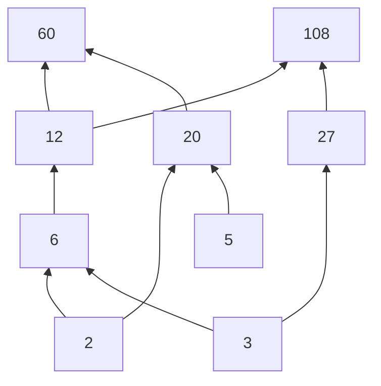

# 离散数学25期末解答

## 一、判断题

### 1. 错

**题目：** 函数 $[本地路径已隐藏] Z\times\mathbb Z\to\mathbb Z,\ f(n,m)=5n+3m$ 是满射且一一对应。

**解答：** 因为 $\gcd(5,3)=1$，对任意整数 $z$，可取 $n=-z,\ m=2z$，则
$$
5n+3m=-5z+6z=z,
$$
所以 $f$ 是满射。

但它不是单射。例如
$$
f(0,0)=0,\quad f(3,-5)=0,
$$
而 $(0,0)\ne(3,-5)$。所以命题为错。

### 2. 对

**题目：** 存在 $m\ge2,n\ge1$，使得 $n$ 个结点的非同构满 $m$ 叉树比 $n+1$ 个结点的更多。

**解答：** 取 $m=2$。满二叉树的结点数必为奇数，因为若内部结点数为 $i$，总结点数为 $2i+1$。

当 $n=1$ 时，有 1 棵满二叉树；当 $n+1=2$ 时，没有满二叉树。因此存在这样的 $m,n$。

### 3. 错

**题目：** 两个等价关系的并仍是等价关系。

**解答：** 不一定。设集合为 $\{1,2,3\}$，
$$
R=\{(1,1),(2,2),(3,3),(1,2),(2,1)\},
$$
$$
S=\{(1,1),(2,2),(3,3),(2,3),(3,2)\}.
$$
它们都是等价关系。但 $R\cup S$ 中有 $(1,2)$ 和 $(2,3)$，却没有 $(1,3)$，不满足传递性。

### 4. 错

**题目：** Dijkstra 算法在有 $n$ 个顶点、$m$ 条边的加权图中求两点间最短路的最坏时间复杂度是 $O(nm)$。

**解答：** Dijkstra 的复杂度依实现而定。邻接矩阵实现通常为 $O(n^2)$；邻接表加堆可为 $O((n+m)\log n)$。题目给出的 $O(nm)$ 不是标准最坏复杂度结论。

### 5. 对

**题目：** 若 $A,B,C$ 为集合，则
$$
(A-B)\cup(A-C)=A\iff A\cap B\cap C=\varnothing.
$$

**解答：**
$$
(A-B)\cup(A-C)
=(A\cap B^c)\cup(A\cap C^c)
=A\cap(B^c\cup C^c)
=A\cap(B\cap C)^c.
$$
它等于 $A$ 当且仅当 $A$ 中没有元素同时属于 $B,C$，即 $A\cap B\cap C=\varnothing$。

### 6. 对

**题目：** 当 $a,b,c$ 都是奇整数时，二次方程 $ax^2+bx+c=0$ 没有有理根。

**解答：** 若有有理根，则判别式
$$
\Delta=b^2-4ac
$$
必须是整数平方。奇数平方模 $8$ 同余于 $1$，且 $4ac\equiv4\pmod8$，所以
$$
\Delta\equiv1-4\equiv5\pmod8.
$$
但平方数模 $8$ 只可能为 $0,1,4$，矛盾。

### 7. 对

**题目：** 题中给出的两张图同构。

**解答：** 两图都是 Petersen 图的不同画法。每个顶点度数均为 3，并且外圈与内星形结构可以通过重命名顶点对应，因此同构。

### 8. 错

**题目：**
$$
\binom{0.5}{3}\binom{0.5}{4}>0.
$$

**解答：**
$$
\binom{1/2}{3}=\frac{(1/2)(-1/2)(-3/2)}{3!}>0,
$$
$$
\binom{1/2}{4}=\frac{(1/2)(-1/2)(-3/2)(-5/2)}{4!}<0.
$$
乘积小于 0，所以命题为错。

### 9. 对

**题目：** 若 $G$ 是二分图，二分为 $(V_1,V_2)$，则 $V_1$ 与 $V_2$ 中顶点度数之和相等。

**解答：** 二分图每条边都连接 $V_1$ 中一个顶点和 $V_2$ 中一个顶点。对任一侧求度数和，每条边都被数一次，所以两侧度数和都等于 $|E|$。

## 二、选择题

### 1. C

**题目：** 对集合上的关系 $T$，设 $t(T)$ 为传递闭包，$s(T)$ 为对称闭包。给定关系 $R,S$，判断哪些式子正确：
$$
\text{A. }t(R\cup S)=t(R)\cup t(S)
$$
$$
\text{B. }t(R\cap S)=t(R)\cap t(S)
$$
$$
\text{C. }s(R\cup S)=s(R)\cup s(S)
$$
$$
\text{D. }s(R\cap S)=s(R)\cap s(S)
$$

**解答：** 对称闭包
$$
s(R)=R\cup R^{-1}.
$$
所以
$$
s(R\cup S)=(R\cup S)\cup(R\cup S)^{-1}
=R\cup S\cup R^{-1}\cup S^{-1}
=s(R)\cup s(S).
$$
C 正确。传递闭包对并、交一般不分配，所以 A、B 不一定成立；D 对交也不一定成立。

### 2. A, C

**题目：** 判断下列逻辑等价式哪些正确，所有变量论域相同：
$$
\text{A. }\forall x(P(x)\land Q(x))\equiv \forall xP(x)\land\forall xQ(x)
$$
$$
\text{B. }\exists x(P(x)\land Q(x))\equiv \exists xP(x)\land\exists xQ(x)
$$
$$
\text{C. }\neg\exists x(P(x)\land Q(x))\equiv \forall x(\neg P(x)\lor\neg Q(x))
$$
$$
\text{D. }\exists x(P(x)\to Q(x))\equiv \exists xP(x)\to\exists xQ(x)
$$

**解答：** A 是全称量词对合取的分配，正确。B 错，因为左右两边的存在量词可能对应不同元素。C 是量词否定和德摩根律，正确。D 中蕴含与存在量词不能这样分配，错误。

### 3. C

**题目：** 用 Huffman 编码处理频率
$$
A:0.10,\ B:0.22,\ C:0.05,\ D:0.15,\ E:0.26,\ F:0.07,\ G:0.06,\ I:0.09
$$
平均每个符号需要多少 bit？选项：2.61, 2.65, 2.79, 2.83。

**解答：** Huffman 合并：
$$
0.05+0.06=0.11,\quad0.07+0.09=0.16,
$$
$$
0.10+0.11=0.21,\quad0.15+0.16=0.31,
$$
$$
0.21+0.22=0.43,\quad0.26+0.31=0.57,
$$
$$
0.43+0.57=1.
$$
平均码长为所有合并权值之和：
$$
0.11+0.16+0.21+0.31+0.43+0.57+1=2.79.
$$
选 C。

### 4. A, C

**题目：** 设 $[本地路径已隐藏] R\to\mathbb R$，对任意 $x,y\in\mathbb R$ 有
$$
f(x+y)=f(x)+f(y).
$$
判断哪些正确：
$$
\text{A. }f(0)=0,\quad \text{B. }f(1)=0,
$$
$$
\text{C. 对每个 }n\in\mathbb N,\ f(n)=nf(1),\quad \text{D. 以上都不对。}
$$

**解答：** 令 $x=y=0$：
$$
f(0)=f(0)+f(0),
$$
故 $f(0)=0$，A 正确。B 不一定，例如 $f(x)=x$。C 用归纳法：若 $f(n)=nf(1)$，则
$$
f(n+1)=f(n)+f(1)=(n+1)f(1).
$$

### 5. A

**题目：** 轮图 $W_4$ 有多少棵非同构无根生成树？选项：3, 5, 6, 8。

**解答：** $W_4$ 有一个中心点和外部 4-圈。生成树按中心点度数可分为 3 种非同构类型：中心度为 1、2、3。因此答案为 3。

### 6. B

**题目：** 设 $S=\{x\in\mathbb N\mid 1\le x\le2025\}$。最多能从 $S$ 中选多少个数构成 $T$，使得任意不同 $x,y\in T$，$x+y$ 都不能被 $|x-y|$ 整除？选项：1012, 675, 506, 405。

**解答：** 任意三个连续整数 $k,k+1,k+2$ 中不能选两个：相邻两数差为 1，必整除和；$k$ 与 $k+2$ 的差为 2，而和为 $2k+2$，也能被 2 整除。所以每 3 个连续整数至多选 1 个，得上界
$$
2025/3=675.
$$
选所有 $1\bmod3$ 的数：
$$
1,4,7,\ldots,2023,
$$
共 675 个。任意两个数差为 3 的倍数，而和模 3 为 2，不可能被差整除。故最大为 675，选 B。

## 三、填空题

### 1. $(p\lor\neg q\lor r)\land(\neg p\lor q\lor r)$

**题目：** 求 $(p\oplus q)\to r$ 的主合取范式。

**解答：** 蕴含式仅当前件真、后件假时为假。$p\oplus q$ 为真当且仅当 $p,q$ 一真一假，所以假赋值是
$$
(p,q,r)=(1,0,0),(0,1,0).
$$
对应主合取范式为
$$
(\neg p\lor q\lor r)\land(p\lor\neg q\lor r).
$$

### 2. $m\le2$

**题目：** 在 $m\le n$ 条件下，求使 $K_{m,n}$ 为平面图的 $m,n$ 条件。

**解答：** 完全二部图 $K_{m,n}$ 平面当且仅当 $m\le2$ 或 $n\le2$。在 $m\le n$ 下，只需写
$$
m\le2.
$$
若 $m,n\ge3$，则含 $K_{3,3}$ 子图，非平面。

### 3. 15

**题目：** $2025$ 有多少个正因子？

**解答：**
$$
2025=45^2=3^4\cdot5^2.
$$
正因子个数为
$$
(4+1)(2+1)=15.
$$

### 4. $\lambda(K_{m,n})=\min(m,n)$

**题目：** 边连通度 $\lambda(G)$ 定义为断开连通图所需删除的最少边数。求 $\lambda(K_{m,n})$。

**解答：** $K_{m,n}$ 中两侧顶点度数分别为 $n$ 和 $m$，最小度为 $\min(m,n)$，所以
$$
\lambda(K_{m,n})\le\min(m,n).
$$
完全二部图中少删于 $\min(m,n)$ 条边不能孤立任何顶点，也不能切断两侧连接。因此
$$
\lambda(K_{m,n})=\min(m,n).
$$

### 5. 144

**题目：** 求
$$
\left(x-\frac2x\right)^9
$$
展开式中 $x^5$ 的系数。

**解答：** 通项为
$$
\binom9k x^{9-k}\left(-\frac2x\right)^k
=\binom9k(-2)^k x^{9-2k}.
$$
令 $9-2k=5$，得 $k=2$。系数为
$$
\binom92(-2)^2=36\cdot4=144.
$$

### 6. $119,120,121$

**题目：** 三个连续正整数依次能被 $7,5,11$ 整除，求最小正整数解。

**解答：** 设为 $x,x+1,x+2$，则
$$
x\equiv0\pmod7,\quad x\equiv4\pmod5,\quad x\equiv9\pmod{11}.
$$
最小解为 $x=119$，于是三个数为
$$
119,120,121.
$$

### 7. 16

**题目：** 顶点用 $\{1,2,3,4\}$ 中不同整数标号，标号保持同构。这样的 4 顶点非同构标号树有多少棵？

**解答：** 标号必须保持，因此不同标号边集给出不同树。由 Cayley 公式，$n$ 个标号顶点的树数为 $n^{n-2}$。取 $n=4$：
$$
4^{4-2}=16.
$$

### 8. $1,-4,8,-16,32,-64$

**题目：** 写出生成函数
$$
\frac{1-2x}{1+2x}
$$
确定的序列前 6 项。

**解答：**
$$
\frac{1-2x}{1+2x}
=(1-2x)(1-2x+4x^2-8x^3+\cdots).
$$
前 6 项为
$$
1,-4,8,-16,32,-64.
$$

### 9. 2160

**题目：** 将 6 个不同苹果分给 John、Alice、Tom、Sunny，恰好一个人没有苹果，有多少种方法？

**解答：** 先选没苹果的人：4 种。剩下 6 个不同苹果分给 3 人且每人至少一个，满射数为
$$
3^6-\binom31 2^6+\binom32 1^6=729-192+3=540.
$$
总数为
$$
4\cdot540=2160.
$$

### 10. 256

**题目：** 若
$$
A\cup B\cup C=\{1,2,3,4,5,6\},\quad A\cap B=\{5\},\quad B\cap C=\{2\},
$$
求集合 $A,B,C$ 的可能情况数。

**解答：** 元素 5 必在 $A,B$ 中且不在 $C$；元素 2 必在 $B,C$ 中且不在 $A$。其余 $1,3,4,6$ 不能落入 $A\cap B$ 或 $B\cap C$，并且至少属于一个集合。

每个自由元素可选：
$$
A,\quad B,\quad C,\quad A\cap C.
$$
共 4 种，因此总数为
$$
4^4=256.
$$

## 四、偏序集

**题目：** 对偏序集
$$
(\{2,3,5,6,12,20,27,60,108\},\mid),
$$
完成以下问题：画 Hasse 图；求极大元；求最小元；求 $\{3,5\}$ 的所有上界；判断 Hasse 图底层无向图是否有 Hamilton 路；给出字典序最小拓扑序。

### 1. Hasse 图

覆盖关系为
$$
2\prec6,\ 2\prec20,\ 3\prec6,\ 3\prec27,\ 5\prec20,
$$
$$
6\prec12,\ 12\prec60,\ 12\prec108,\ 20\prec60,\ 27\prec108.
$$

### 2. 极大元

极大元为
$$
60,\ 108.
$$

### 3. 最小元

不存在最小元。若有最小元，它必须整除集合中所有元素；但集合中没有 1，且 2 不整除 3，3 不整除 2。

### 4. $\{3,5\}$ 的所有上界

上界必须同时被 3 和 5 整除，即被 15 整除。集合中只有 60 满足，所以所有上界为
$$
\{60\}.
$$

### 5. Hamilton 路

存在 Hamilton 路，例如
$$
5,20,2,6,3,27,108,12,60.
$$

### 6. 字典序最小拓扑序

每次选当前入度为 0 的最小元素，得到
$$
2,3,5,6,12,20,27,60,108.
$$

## 五、有向图

**题目：** 给定 Fig. 1 中的有向图 $G$。求强连通分量；求长度为 4 的路径数及其中回路数。

按顶点顺序 $A,B,C,D$，邻接矩阵为
$$
M=
\begin{pmatrix}
0&0&1&1\\
1&0&1&1\\
1&0&0&1\\
1&0&0&0
\end{pmatrix}.
$$

### 1. 强连通分量

$A,C,D$ 互相可达；$B$ 可到达 $A,C,D$，但其他点不能回到 $B$。所以强连通分量为
$$
\{A,C,D\},\quad\{B\}.
$$

### 2. 长度为 4 的路径数与回路数

$$
M^4=
\begin{pmatrix}
4&0&1&3\\
5&0&3&5\\
3&0&2&3\\
1&0&2&2
\end{pmatrix}.
$$
$M^4$ 所有元素之和是长度为 4 的有向路径数：
$$
34.
$$
长度为 4 的回路数是迹：
$$
\operatorname{tr}(M^4)=4+0+2+2=8.
$$

## 六、半径、直径与中心

**题目：** 对 Fig. 2 中的连通简单图，求 Fig. 2(a) 的半径 $r(G)$；Fig. 2(b) 的直径 $d(G)$；Fig. 2(c) 的中心；并判断对任意连通简单图是否总有
$$
r(G)\le d(G)\le2r(G).
$$

### 1. Fig. 2(a) 的半径

由图中最短路计算，最小离心率为 5，所以
$$
r(G)=5.
$$

### 2. Fig. 2(b) 的直径

图为 $3\times7$ 网格，最远两点是对角角点，距离为
$$
(3-1)+(7-1)=8.
$$
所以 $d(G)=8$。

### 3. Fig. 2(c) 的中心

逐点计算离心率，$a,b$ 的离心率最小，所以中心为
$$
\{a,b\}.
$$

### 4. 证明不等式

半径是最小离心率，直径是最大离心率，因此
$$
r(G)\le d(G).
$$
取中心点 $u$，任意顶点 $x$ 都有 $d(u,x)\le r(G)$。对任意顶点 $x,y$，
$$
d(x,y)\le d(x,u)+d(u,y)\le2r(G).
$$
取最大值得
$$
d(G)\le2r(G).
$$
所以命题恒真。

## 七、正则图

**题目：** 简单无向图若每个顶点度数相同则称正则图。证明每个 2-正则图是不相交圈的并；画两个非同构的 6 顶点 3-正则图；判断它们是否平面；求它们的着色数。

### 1. 证明 2-正则图是不相交圈的并

任取一个连通分量。每个顶点度数为 2，从任一顶点沿边走，在有限图中必然回到已访问顶点。由于连通且每点度数为 2，该连通分量只能形成一个圈。若原图不连通，则每个连通分量都是圈，因此整个图是不相交圈的并。

### 2. 两个非同构 3-正则图

可取：

1. 完全二部图 $K_{3,3}$；
2. 三棱柱图。

它们非同构，因为 $K_{3,3}$ 无三角形，而三棱柱图含三角形。

### 3. 平面性

$K_{3,3}$ 非平面；三棱柱图可无交叉画出，所以平面。

### 4. 着色数

$K_{3,3}$ 是二分图且有边，所以
$$
\chi(K_{3,3})=2.
$$
三棱柱图含三角形，至少 3 色；用 3 色可完成着色，所以
$$
\chi(\text{三棱柱})=3.
$$

## 八、图 $G_n$ 的生成树

**题目：** $G_n$ 由一条 $n$ 个顶点的路加一个新顶点组成，新顶点与路上每个顶点相邻。设 $a_n$ 为 $G_n$ 的生成树数，且 $a_1=1$。求 $a_2$；解递推
$$
a_n=3a_{n-1}-a_{n-2}\quad(n\ge3);
$$
给定 Fibonacci 数 $f_1=f_2=1$，证明 $a_n=f_{2n}$。

### 1. $a_2=3$

$G_2$ 是三角形 $K_3$。三角形生成树可由删去任意一条边得到，共 3 棵，所以
$$
a_2=3.
$$

### 2. 解递推

特征方程为
$$
\lambda^2-3\lambda+1=0,
$$
根为
$$
\lambda_1=\frac{3+\sqrt5}{2},\quad \lambda_2=\frac{3-\sqrt5}{2}.
$$
由 $a_1=1,a_2=3$ 得
$$
a_n=\frac1{\sqrt5}\left[\left(\frac{3+\sqrt5}{2}\right)^n-\left(\frac{3-\sqrt5}{2}\right)^n\right].
$$

### 3. 证明 $a_n=f_{2n}$

先看初值：
$$
a_1=1=f_2,\quad a_2=3=f_4.
$$
Fibonacci 偶数项满足
$$
f_{2n+2}=3f_{2n}-f_{2n-2}.
$$
证明如下：
$$
f_{2n+2}=f_{2n+1}+f_{2n}=2f_{2n}+f_{2n-1},
$$
又
$$
f_{2n-1}=f_{2n}-f_{2n-2},
$$
故
$$
f_{2n+2}=3f_{2n}-f_{2n-2}.
$$
因此 $a_n$ 与 $f_{2n}$ 有相同初值和相同递推，由归纳法
$$
a_n=f_{2n}.
$$
